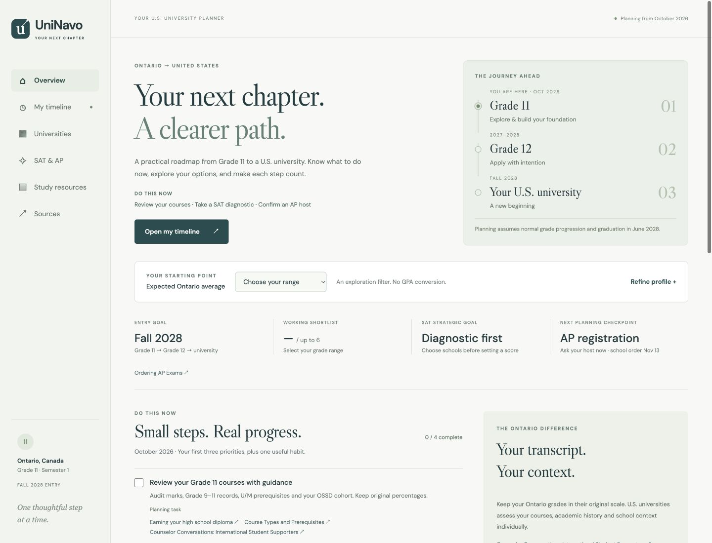

# UniNavo

**Live site:** https://ivyparc.github.io/UniNavo/ · **Implementation PR:** https://github.com/ivyparc/UniNavo/pull/1

A source-linked U.S. university admission planner for an Ontario student in Grade 11, Semester 1 (October 2026), targeting Fall 2028 entry. The planner assumes normal progression to Grade 12 in 2027–28 and high-school graduation in June 2028. This is planning guidance, not an admission guarantee.

## Run locally

Requires Node.js 22.18+ (Node 24 recommended) and pnpm 11.25.0. The package manager version is recorded in `package.json`.

```sh
pnpm install --frozen-lockfile
pnpm dev
```

Open the URL printed by Vite, normally `http://127.0.0.1:5173/`.

```sh
pnpm validate     # data completeness, references, dates and IDs
pnpm typecheck
pnpm lint
pnpm test         # 16 recommendation, calendar and localization regression tests
pnpm build       # production output in dist/
pnpm preview     # preview the production build
pnpm check:links  # network check; writes research/link-check.json
```

No account, API key, database or backend is required. Language preference, profile, task completion and saved schools use browser localStorage. A blocked/corrupt store falls back to the current session. Browser data is not synchronized across devices. Google Fonts is the only runtime third-party asset request; system fonts are fallbacks. There is no analytics or form submission.

## Experience

- Language: the header’s **한국어 / English** button switches all six views, university facts and the complete timeline. The choice persists in this browser; filters, saved schools and task IDs stay unchanged. Korean university/major search is supported. Official source document titles, publishers, reference cycles and book titles retain their original wording. No translation API is used.

- Overview: three current priorities with large checkboxes, always-visible instructions, and two clear routes to universities or SAT/AP. The fourth habit and Ontario requirements remain under an optional disclosure. Profile editing lives on the university page.
- Timeline: 23 months, October 2026–August 2028, 72 tasks, all months initially expanded, visible task details, checkboxes, a stage filter with the default label “Select”, and a hide-completed option.
- Universities: nine concise cards, seven grade ranges, advanced filters, expandable source-linked detail sections and up to six working recommendations. Saved schools are separate from generated picks.
- SAT & AP: confirmed 2026–27 SAT dates, separately labeled anticipated 2027–28 dates, four AP priorities and university-specific credit examples.
- Study resources: purpose and link first; publisher editions, explanations and sources expand on demand. Preorder information is preserved.
- Sources: searchable source register with exact URLs, publisher, reviewed date and applicable cycle.

Body text is 16–18px and secondary text is at least 14px. Desktop university/AP cards use two columns and mobile uses one. SAT score comparisons, score-submission rules and AP credit details are folded until requested. Task instructions and their sources are shown directly, without a separate expand button, in both languages. Important entry-year uncertainty remains visible.

## Structure

```text
src/main.ts                 Views, accessible native controls and interaction
src/style.css               Responsive layout and focus/reduced-motion styles
src/types.ts                Shared types and supported grade bands
src/recommendations.ts      Transparent conservative planning scenarios
src/storage.ts              Resilient browser-local persistence
src/i18n.ts                 Saved language, text localization, stable option values
src/locales/ko-*.ts          Korean UI, university, planning and timeline translations
src/data/index.ts           Research loading and source register
src/data/strategies.ts      Editorial choices, majors and sourced score ranges
src/data/timeline.ts        Monthly tasks with stable completion IDs
research/west.json          ASU, Arizona, Oregon, Colorado Boulder
research/east.json          MSU, IU Bloomington, Penn State University Park, NYU
research/iowa.json          Iowa State
research/planning.json      Official exam calendars, Ontario/entry guidance, books
research/pathways.json      Transfer strategy, separate from freshman admission
research/link-check.json    HTTP verification results, not a claim-accuracy audit
scripts/validate.ts         Data and source validation
scripts/check-links.mjs     Conservative link reachability checker
tests/planner.test.ts      Behavioral/data regression tests
```

## Source policy

Research snapshot: **October 21, 2026**. University admissions pages and official catalogs are primary; institutional profiles/Common Data Sets support cohort statistics. College Board, Common App, Ontario education and U.S. government pages support general guidance. Publisher pages establish book titles/editions. External rankings and admission aggregators are not used to establish requirements.

Each consequential university fact has text, a status, and source IDs. Sources retain exact URL, title, publisher, date reviewed and cycle. An unknown has an explicit status, rather than a fabricated number. “Not verified” means this research did not establish the value; it is not a claim that the university does not publish it. A current page that lacks an entry year is not relabeled as a Fall 2028 commitment.

Where a page was accessible to the research browser but blocks a later HTTP check, keep the distinction. The link report records status/redirects and cannot prove that a claim is correct. It does not bypass authentication or bot protection.

## Recommendations and limitations

The categories are manually authored, conservative **exploration scenarios**, not a calibrated admissions model. No Ontario percentage is converted to a U.S. GPA. Grade bands are inputs, not university cutoffs. Full academic history, rigor, course prerequisites, essays/activities, school context, language evidence, citizenship, program and campus may change the outcome.

“More Realistic” is only displayed after the user reports course eligibility checks and strong preparation; it is still not a safety. Specialized interests and an unreviewed U.S.-citizen/permanent-resident route cannot inherit broad international-program Target labels. SAT comparisons help preparation/submission decisions and never automatically improve a category. Verified acceptance rates are descriptive cohort data, not personal odds.

The six-pick selection first preserves available planning categories, then uses editorial brand/strategy ordering. There may be fewer than six: 60–70% receives no supported direct-entry shortlist in this dataset; 70–75% receives limited Reach exploration leads. Low-band users see a separate transfer strategy. NYU always remains a reach. “Brand Recognition” is an editorial comparison, not a measured Korean recognition survey or an admissions statistic.

Important open items:

- Fall 2028 deadlines and most entry-year testing commitments are not yet confirmed.
- 2027–28 SAT dates are **anticipated**, including the updated October 9, 2027 date. Registration/release dates remain unpublished. 2028 AP dates remain unpublished in the reviewed schedule.
- Several Ontario course-equivalency rules, English waivers, CSS Profile/need-aid details and program-specific rules need direct confirmation.
- ASU current international and general deadline pages show different cycles; Oregon insurance amounts conflict across official pages.
- NYU New York testing scope needs confirmation; the current NYU Abu Dhabi page is not silently generalized to NYC.
- Costs retain their year, campus, scope and exclusions. IU's retrieved international estimate has no labeled year; Penn State's projection is tuition, not a full international budget.
- ASU’s verified acceptance statistic covers Campus Immersion, not Tempe alone. SAT distributions identify admitted versus enrolled cohorts and score-submitter scope.
- Citizenship is unknown by default. Ontario attendance does not establish Canadian citizenship, U.S. aid eligibility or visa requirements.

## Updating research

1. Open the exact official source. Identify entry year, applicant category, campus and program before editing any value.
2. Update the corresponding JSON fact, source IDs, status and source cycle. Record the actual review date; do not bulk-renew dates without reviewing the underlying sources. If updates are incremental, relax the current single-snapshot date assertion in `scripts/validate.ts` to validate per-source dates and update the UI snapshot labeling appropriately.
3. Preserve unknowns/conflicts until resolved. Record statistics with cohort, counts/denominator where applicable, and score-submitter/admitted/enrolled scope. Never infer Ontario equivalencies.
4. Review affected strategies in `src/data/strategies.ts`, score ranges and timeline entries. Keep task IDs stable for browser checklist continuity, or deliberately version the storage key if semantics change.
5. Update the corresponding Korean text in `src/locales/` when changing English content. The English research remains canonical; preserve the same uncertainties, dates and exclusions in Korean. Run validate, typecheck, lint, tests and build. Check changed source links, and inspect desktop/tablet/mobile, keyboard navigation and the detail dialog.
6. Update this README and the research coverage notes. Review the actual 2027–28 application cycle before using this snapshot to submit applications.

## Repository and deployment

The only project repository is **https://github.com/ivyparc/UniNavo**. Work is prepared on `codex/us-college-planner`; main history is preserved. CI runs validation, typecheck, lint, tests and build.

The production `dist/` output is static. `pnpm build:pages` builds with the `/UniNavo/` asset base for GitHub Pages. Hash-based routes need no server-side fallback beyond `index.html`.

GitHub Pages publication uses a separate `codex/site` branch in this same repository containing only the built static output and `.nojekyll`. Source development remains on `codex/us-college-planner`. Updating the deployed build requires rebuilding and publishing that artifact branch; source changes do not silently redeploy the site.

### Republishing the existing Pages branch

After reviewing and committing source/data updates, run `pnpm build:pages`. Publish the resulting `dist/` files to the root of the existing `codex/site` branch, retaining `.nojekyll`, with a normal new commit and fast-forward push to **ivyparc/UniNavo**. Use a separate working tree for that branch so generated files cannot replace the source checkout. Never force-push or change repository identity. Check the repository's Pages deployment result and open the live URL before claiming the update is published. No Pages settings change is needed for subsequent artifact updates.

### Verification record

- Local validation, typecheck, lint, 11 tests and both standard/Pages production builds passed.
- GitHub Actions `Validate planner` passed for the implementation commit.
- Browser inspection at 1440px desktop, 820px tablet and 390px mobile found no document-level horizontal overflow. The mobile SAT table scrolls inside its container.
- Verified grade filtering, six-pick generation, low-band empty state, advanced state filter, university detail sources, Escape/focus return, AP tab, source search, checklist persistence and saved-school persistence.
- The deployed Pages URL loaded successfully with no observed console errors; navigation and the university detail dialog worked on the production bundle.


